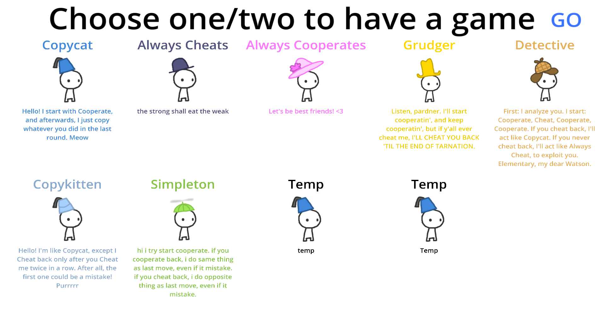

# DFA-With-Game-Theory
Converting Game Theory AIs into Deterministic Finite Automatas

Assets and Inspiration Taken From:  
https://ncase.me/trust/

 

Video explaining Game Theory:  
https://youtu.be/mScpHTIi-kM?si=2mAWRgGnLeqcrbia

 

Play the game in the web:  
https://requiem53.itch.io/deterministic-finite-automata-in-game-theory

 

~~Godot version used: Godot_v4.2.1-stable_mono_win64~~  
Godot version used: Godot_v4.3-stable_mono_win64 :3 

 

Screenshots:

.png)

